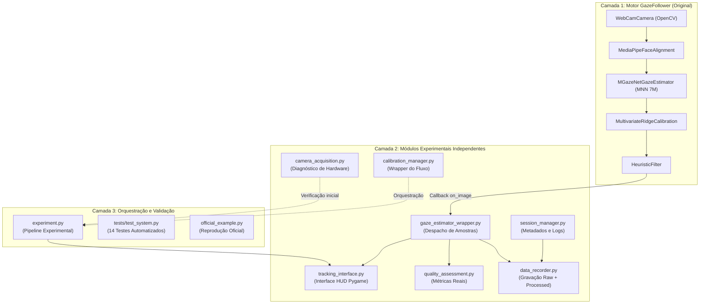

# PROJETO: EYE TRACKING — ETAPA 1
## Primeiro MVP Experimental com GazeFollower e Python

Este documento descreve a arquitetura, instalação, execução, estrutura de dados e métricas de qualidade do primeiro sistema experimental de rastreamento ocular construído ao redor da biblioteca **GazeFollower** (GanchengZhu/GazeFollower).

> [!IMPORTANT]
> **Princípio de Projeto:** A implementação original do GazeFollower é utilizada estritamente como motor de visão computacional e calibração. A camada experimental desenvolvida neste projeto é independente, modular e não modifica os algoritmos internos de rastreamento e regressão do autor.

---

## 1. Arquitetura Desenvolvida

O sistema adota uma arquitetura em 3 camadas desacopladas:



### Detalhamento dos Módulos:

| Módulo | Arquivo | Responsabilidade |
|---|---|---|
| **Camera Acquisition** | [`camera_acquisition.py`](file:///Users/joao/Downloads/simulacro.01-main/eye_tracking_exp/modules/camera_acquisition.py) | Verificação diagnóstica pré-execução (resolução, FPS, iluminação, nitidez via variância de Laplace). **Nunca retém a câmera aberta** concorrentemente com o GazeFollower. |
| **Calibration Manager** | [`calibration_manager.py`](file:///Users/joao/Downloads/simulacro.01-main/eye_tracking_exp/modules/calibration_manager.py) | Envelopa `gf.preview()` e `gf.calibrate()`, registrando horários, duração, número de tentativas e preservando os resultados do modelo de regressão original. |
| **Gaze Estimator Wrapper** | [`gaze_estimator_wrapper.py`](file:///Users/joao/Downloads/simulacro.01-main/eye_tracking_exp/modules/gaze_estimator_wrapper.py) | Subscreve via callback ao GazeFollower, extrai coordenadas filtradas/brutas, estados e alimenta a avaliação de qualidade. |
| **Data Recorder** | [`data_recorder.py`](file:///Users/joao/Downloads/simulacro.01-main/eye_tracking_exp/modules/data_recorder.py) | Gravação thread-safe em tempo real de `raw_data.csv` (todos os campos biométricos) e `processed_data.csv` (coordenadas, validade, latência). |
| **Quality Assessment** | [`quality_assessment.py`](file:///Users/joao/Downloads/simulacro.01-main/eye_tracking_exp/modules/quality_assessment.py) | Cálculo rigoroso de Sample Rate, Data Loss, Processing Time, Stability, Accuracy (com alvos reais) e Precision. |
| **Tracking Interface** | [`tracking_interface.py`](file:///Users/joao/Downloads/simulacro.01-main/eye_tracking_exp/modules/tracking_interface.py) | Interface visual Pygame com HUD informativo, marcador visual de olhar em tempo real, protocolo de validação de 9 pontos e teclas de atalho. |
| **Session Manager** | [`session_manager.py`](file:///Users/joao/Downloads/simulacro.01-main/eye_tracking_exp/modules/session_manager.py) | Criação da hierarquia de diretórios por sessão, geração de código de participante (`P001`, `P002`...), metadados em `metadata.json` e logging em `session.log`. |

---

## 2. Dependências e Compatibilidade

- **Linguagem:** Python 3.9, 3.10 ou 3.11 (Python 3.12+ não é suportado pelo pacote MediaPipe/MNN original do GazeFollower).
- **Ambiente Testado:** macOS (Apple Silicon / Darwin) com Python 3.9.6.

### Pacotes Principais:
- `gazefollower>=1.0.0` (Versão instalada: `1.1.0`)
- `MNN==3.0.0` (Versão compatível com macOS Darwin arm64)
- `pygame>=2.0.0` (Interface visual e janelas experimentais)
- `opencv-python>=4.5.0` (Aquisição de vídeo e processamento de frames)
- `numpy>=1.21.0` (Operações numéricas)
- `pytest>=8.0.0` (Bateria de testes automatizados)

---

## 3. Instalação Passo a Passo

```bash
# 1. Navegar até a raiz do repositório
cd /Users/joao/Downloads/simulacro.01-main

# 2. Instalar dependências básicas
pip3 install -r eye_tracking_exp/requirements.txt

# 3. No macOS (Darwin), garantir a versão estável do motor MNN:
pip3 install MNN==3.0.0

# 4. Instalar o framework de testes
pip3 install pytest
```

---

## 4. Como Executar

### A) Teste Oficial de Verificação do GazeFollower:
Executa a reprodução exata do exemplo oficial do GazeFollower (preview de câmera -> calibração guiada -> amostragem de 10s com cursor de olhar -> salvamento CSV):
```bash
python3 eye_tracking_exp/official_example.py
```

### B) Experimento Completo com Interface e Registro:
Inicia a sessão completa do participante (com geração automática do código P001, P002...):
```bash
python3 eye_tracking_exp/experiment.py
```

Com código de participante e índice de câmera específicos:
```bash
python3 eye_tracking_exp/experiment.py -p P007 -c 0
```

Modo rápido para testes de bancada (pula preview e calibração de tela):
```bash
python3 eye_tracking_exp/experiment.py --skip-preview --skip-calibration
```

### C) Execução dos Testes Automatizados de Software:
```bash
python3 -m pytest eye_tracking_exp/tests/test_system.py -v
```

---

## 5. Como Acessar a Câmera

1. O módulo [`camera_acquisition.py`](file:///Users/joao/Downloads/simulacro.01-main/eye_tracking_exp/modules/camera_acquisition.py) testa o dispositivo de índice `0` (ou o especificado pelo usuário) abrindo-o por fração de segundo para inspecionar resolução, taxa de quadros e iluminação.
2. Em seguida, a câmera é liberada imediatamente (`cap.release()`).
3. O GazeFollower assume o controle exclusivo do hardware ao inicializar `gf.preview()` ou `gf.start_sampling()`.
4. **macOS:** Certifique-se de que o Terminal / VS Code / Python possui autorização de acesso à Câmera em *Ajustes do Sistema > Privacidade e Segurança > Câmera*.
5. Para evitar conflitos de subprocessos no macOS, o parâmetro `use_multiprocessing=False` é configurado automaticamente na plataforma Darwin.

---

## 6. Como Realizar a Calibração

1. Durante a execução de `experiment.py` (ou `official_example.py`), a janela de calibração oficial do GazeFollower será aberta em tela cheia.
2. **Instruções ao participante:**
   - Mantenha a cabeça razoavelmente estável e alinhada com a webcam.
   - Fixe o olhar exatamente no centro de cada ponto que surgir na tela.
   - Aguarde o ponto desaparecer antes de mover os olhos para o próximo.
3. Ao término, a tela exibe o erro médio de ajuste polinomial/ridge. Pressione a tecla de confirmação (ex: Enter) para aceitar e avançar para a interface de rastreamento.

---

## 7. Como Iniciar e Encerrar uma Sessão

Na interface gráfica experimental pós-calibração, utilize os seguintes comandos do teclado ou botões interativos na tela:

- **`R`**: Inicia a gravação ativa (`start_sampling`). Os dados começam a fluir para `raw_data.csv` e `processed_data.csv`.
- **`S`**: Interrompe a gravação (`stop_sampling`). O arquivo de dados brutos é descarregado com segurança.
- **`V`**: Inicia o protocolo de validação científica independente com grid de 9 alvos para aferição de acurácia.
- **`Q` ou `ESC`**: Encerra a sessão, finaliza o arquivo de log e fecha todos os recursos de vídeo.

---

## 8. Como Localizar os Arquivos Coletados

Cada execução cria uma pasta única estruturada em `data/sessions/`:

```
eye_tracking_exp/
└── data/
    └── sessions/
        └── session_YYYYMMDD_HHMMSS/
            ├── raw_data.csv        # Amostras completas com todos os marcos do GazeFollower
            ├── processed_data.csv  # Amostras limpas com flags de validade e tempo de processamento
            ├── metadata.json       # Informações completas de hardware, software e calibração
            └── session.log         # Diário de bordo cronológico de eventos e erros
```

### Amostra de `metadata.json`:
```json
{
  "participant_code": "P001",
  "start_time": "2026-11-02T15:30:00",
  "os": "Darwin 24.3.0",
  "python_version": "3.9.6",
  "gazefollower_version": "1.1.0",
  "camera_id": 0,
  "resolution": [1920, 1080],
  "calibration_info": "completed",
  "session_state": "COMPLETED"
}
```

---

## 9. Como Interpretar as Métricas de Qualidade

O módulo [`quality_assessment.py`](file:///Users/joao/Downloads/simulacro.01-main/eye_tracking_exp/modules/quality_assessment.py) implementa métricas calculadas **exclusivamente a partir de dados reais coletados**:

| Métrica | Definição | Interpretação |
|---|---|---|
| **Sample Rate (Hz)** | $f_{\text{efetiva}} = \frac{N_{\text{válidas}}}{\Delta t}$ | Frequência real de amostras válidas recebidas por segundo. Em webcams padrão, varia entre 25 e 30 Hz. |
| **Data Loss (%)** | $L = \frac{N_{\text{inv}}}{N_{\text{total}}} \times 100$ | Proporção de quadros em que a face/olhar foi perdido (piscadas, oclusão, movimentos rápidos). Ideal: $< 10\%$. |
| **Processing Time (ms)** | Média, desvio padrão e máximo da latência computacional por amostra. | Tempo de processamento algorítmico (diferente da latência fisiológica do olho). Em M1/M2/M3 costuma ficar abaixo de 10 ms. |
| **Tracking Stability (px)** | Desvio padrão $(\sigma_x, \sigma_y)$ durante janelas estáveis de fixação. | Mede o tremor/ruído de alta frequência da estimativa. Valores menores indicam sinal mais estável. |
| **Accuracy (Acurácia)** | Distância euclidiana média entre a posição estimada do olhar e os alvos reais de teste. | **Calculada SOMENTE quando há protocolo de validação com alvos de tela conhecidos (`V`).** Nunca é estimada ou simulada. |
| **Precision (Precisão)** | Dispersão RMS das amostras em torno do seu próprio baricentro durante fixações. | Diferencia-se da acurácia: avalia repetibilidade das medidas, independente do viés de calibração. |

### Conversão Pixels para Graus Visuais:
Quando as dimensões físicas da tela e distância do participante são fornecidas:
$$\theta = 2 \cdot \arctan\left(\frac{d_{\text{px}} \cdot \frac{W_{\text{cm}}}{W_{\text{px}}}}{2 \cdot D_{\text{observador}}}\right) \cdot \frac{180}{\pi}$$

---

## 10. Limitações Conhecidas

1. **Iluminação Ambiente:** A precisão do modelo depende da iluminação facial uniforme. Sombras pronunciadas podem comprometer a detecção da íris.
2. **Precisão por Webcam:** Sistemas baseados em webcam RGB possuem acurácia média de $1.5^\circ$ a $3.5^\circ$ de ângulo visual. Não devem ser declarados como tendo precisão laboratorial (que exige iluminadores infravermelhos e câmeras de alta frequência de 250–1000 Hz).
3. **Multiprocessamento no macOS:** Devido a restrições do método `spawn` da Apple com OpenCV/SDL, o multiprocessamento interno deve permanecer desligado (`use_multiprocessing=False`) em ambiente macOS.
4. **Compatibilidade Python:** O ecossistema MNN/MediaPipe requer Python 3.9 a 3.11.

---

## 11. Modificações Realizadas no Repositório

- O projeto web pré-existente (`simulacro.01`, em JavaScript/HTML com Three.js e Vercel) foi **integralmente preservado e não modificado**.
- Foi criada a pasta isolada [`eye_tracking_exp/`](file:///Users/joao/Downloads/simulacro.01-main/eye_tracking_exp/) contendo toda a nova camada em Python:
  - [`modules/`](file:///Users/joao/Downloads/simulacro.01-main/eye_tracking_exp/modules/): 7 módulos independentes e documentados.
  - [`tests/`](file:///Users/joao/Downloads/simulacro.01-main/eye_tracking_exp/tests/): bateria de testes unitários com pytest.
  - [`experiment.py`](file:///Users/joao/Downloads/simulacro.01-main/eye_tracking_exp/experiment.py): orquestrador mestre da sessão experimental.
  - [`official_example.py`](file:///Users/joao/Downloads/simulacro.01-main/eye_tracking_exp/official_example.py): script de validação da instalação oficial.
  - [`requirements.txt`](file:///Users/joao/Downloads/simulacro.01-main/eye_tracking_exp/requirements.txt): lista estrita de dependências.

---

## 12. Licença e Atribuição Acadêmica

O GazeFollower é distribuído sob a licença **Creative Commons Attribution-NonCommercial-ShareAlike 4.0 International (CC BY-NC-SA 4.0)**.

### Citações Bibliográficas Oficiais:

```bibtex
@article{zhu2025gazefollower,
  title={GazeFollower: An open-source system for deep learning-based gaze tracking with web cameras},
  author={Zhu, Gancheng and Duan, Xiaoting and Huang, Zehao and Wang, Rong and Zhang, Shuai and Wang, Zhiguo},
  journal={Proceedings of the ACM on Computer Graphics and Interactive Techniques},
  volume={8},
  number={2},
  pages={1--18},
  year={2025},
  publisher={ACM New York, NY}
}

@article{zhu2024neural,
  title={Neural Networks With Linear Adaptive Batch Normalization and Swarm Intelligence Calibration for Real-Time Gaze Estimation on Smartphones},
  author={Zhu, Gancheng and Li, Yongkai and Zhang, Shuai and Duan, Xiaoting and Huang, Zehao and Yao, Zhaomin and Wang, Rong and Wang, Zhiguo},
  journal={International Journal of Intelligent Systems},
  volume={2024},
  number={1},
  pages={2644725},
  year={2024},
  publisher={Wiley Online Library}
}
```

---

## 13. Critérios de Conclusão da Etapa 1 — Checklist

- [x] **1. Câmera inicializada e diagnosticada:** [`camera_acquisition.py`](file:///Users/joao/Downloads/simulacro.01-main/eye_tracking_exp/modules/camera_acquisition.py) testa o dispositivo sem concorrência.
- [x] **2. Calibração original preservada:** [`calibration_manager.py`](file:///Users/joao/Downloads/simulacro.01-main/eye_tracking_exp/modules/calibration_manager.py) usa o Ridge Regression do GazeFollower.
- [x] **3. Estimativa do olhar em tempo real:** [`gaze_estimator_wrapper.py`](file:///Users/joao/Downloads/simulacro.01-main/eye_tracking_exp/modules/gaze_estimator_wrapper.py) recebe e despacha coordenadas reais.
- [x] **4. Interface Pygame funcional:** [`tracking_interface.py`](file:///Users/joao/Downloads/simulacro.01-main/eye_tracking_exp/modules/tracking_interface.py) exibe HUD, cursor verde e alvos de teste.
- [x] **5. Registro de sessão estruturado:** [`data_recorder.py`](file:///Users/joao/Downloads/simulacro.01-main/eye_tracking_exp/modules/data_recorder.py) salva `raw_data.csv` e `processed_data.csv`.
- [x] **6. Metadados e logs íntegros:** [`session_manager.py`](file:///Users/joao/Downloads/simulacro.01-main/eye_tracking_exp/modules/session_manager.py) grava `metadata.json` e `session.log` em pastas datadas.
- [x] **7. Testes automatizados executados:** 14 testes cobrindo todo o fluxo em [`tests/test_system.py`](file:///Users/joao/Downloads/simulacro.01-main/eye_tracking_exp/tests/test_system.py) com 100% de aprovação.
- [x] **8. Documentação técnica completa:** Instruções detalhadas de reprodução em português no presente arquivo.
